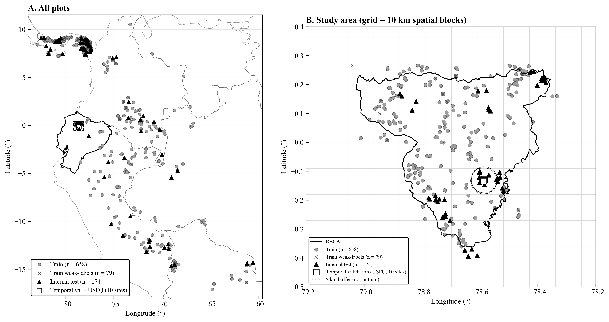
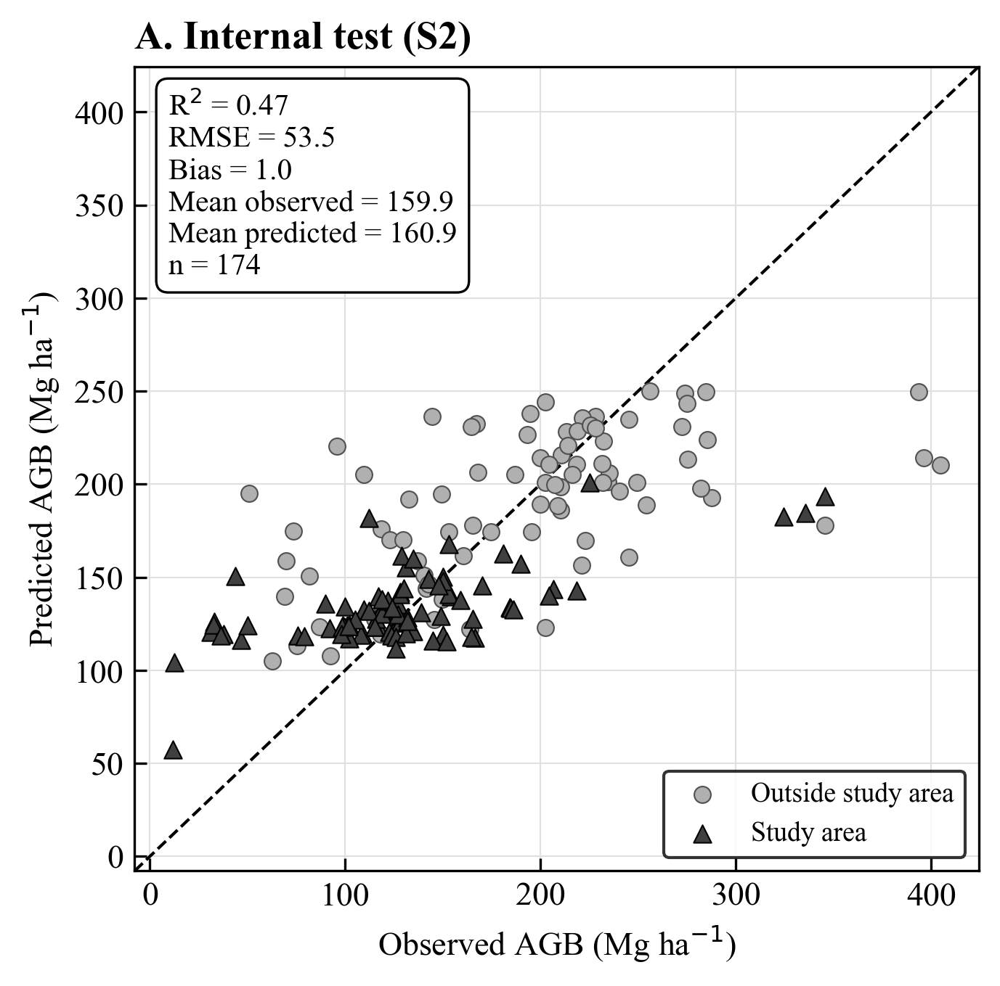
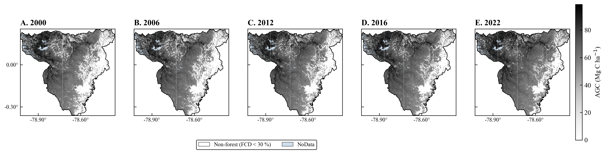
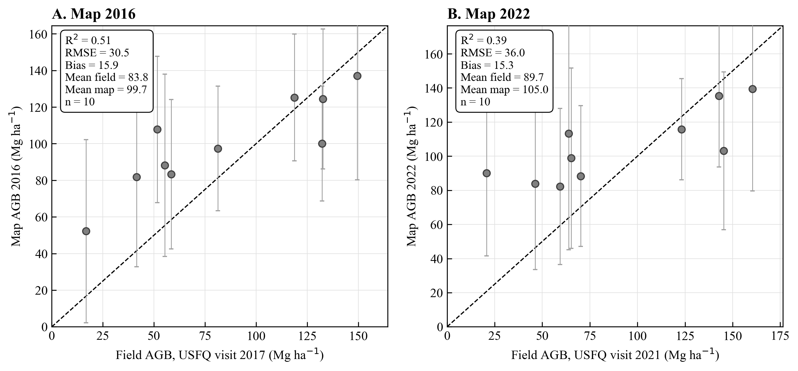
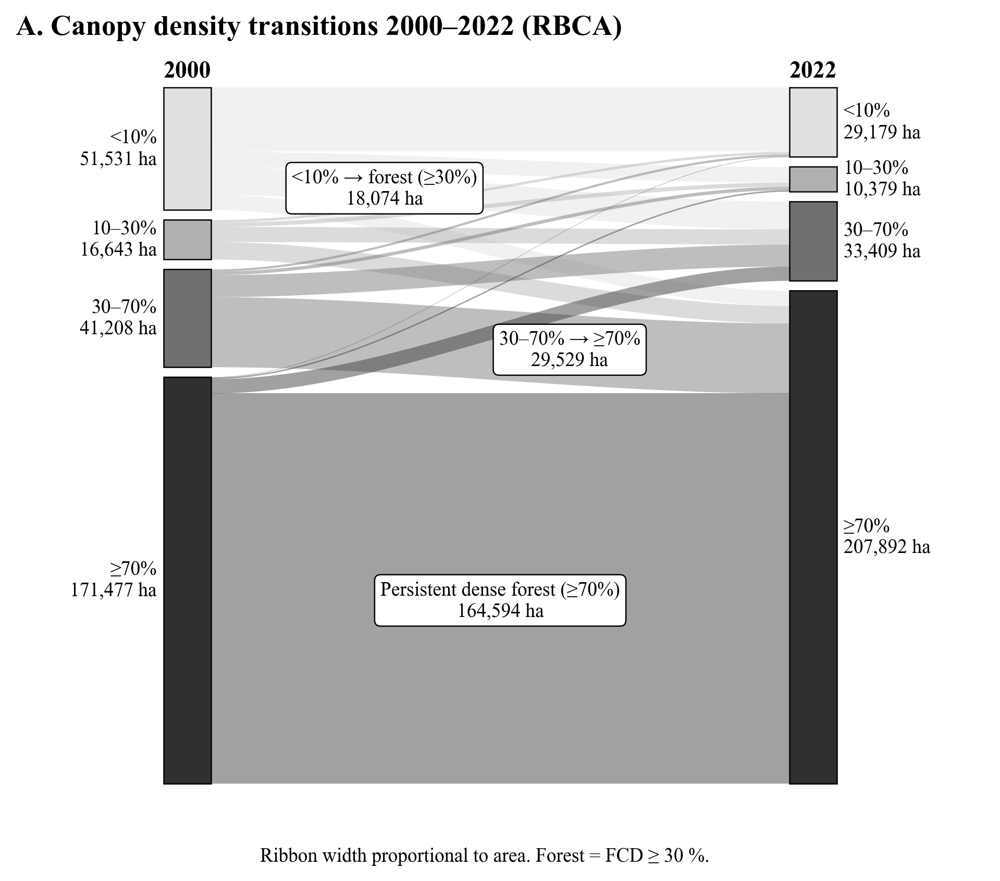
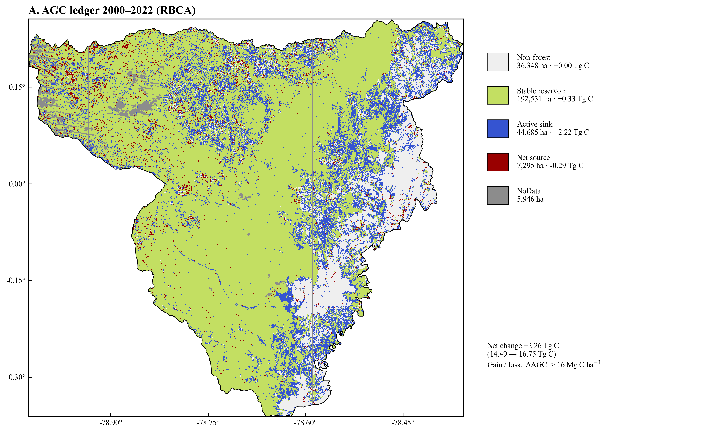
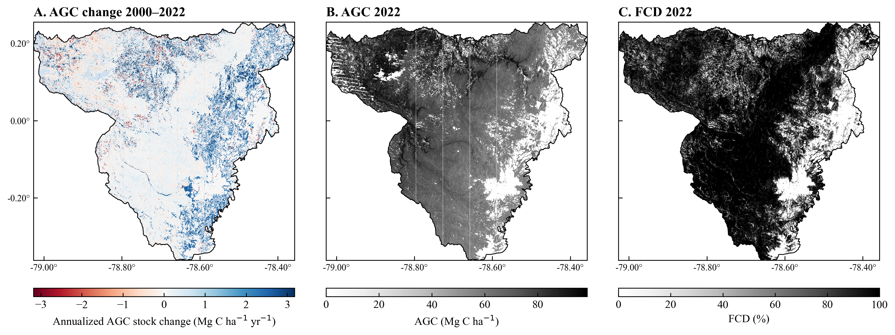

# AGC Chocó Andino Biosphere Reserve

**Above-ground carbon dynamics in the Chocó Andino Biosphere Reserve, Ecuador**  
*Ecological Indicators* — ECOLIND-60399

---

## Overview

This repository contains all analysis code and tabular data for a study estimating above-ground carbon (AGC) stocks and their change across five periods (2000, 2006, 2012, 2016, 2022) in the Chocó Andino Biosphere Reserve (RBCA), northwestern Ecuador.

A Random Forest model trained on field biomass plots and satellite predictors (Landsat, PALSAR, SRTM, Forest Canopy Density) was applied to produce wall-to-wall AGC maps at 30 m resolution. Carbon stocks were estimated for the forest domain defined by FCD ≥ 30%.

---

## Study area and training data



Training data include field plots from the Avitabile et al. pantropical dataset and USFQ field campaigns in the RBCA. Spatial cross-validation used 10 km blocks to avoid leakage between train and test sets.

---

## Model performance



Selected scenario S2 (weak-label AGB = 15 Mg ha⁻¹, with PALSAR): R² = 0.47, RMSE = 53.5 Mg ha⁻¹ on the spatially blocked internal test set (n = 174).

---

## AGC maps (2000–2022)



Wall-to-wall AGC maps for the five study periods. Non-forest pixels (FCD < 30%) are masked. Maps produced with `07_predict_maps.py`.

---

## Map validation



---

## FCD transitions and carbon ledger





---

## AGC change maps



---

## Repository structure

```
├── SCRIPTS/
│   ├── 01_data_exploration.ipynb       # Data exploration and study area shapefiles
│   ├── 02_download_images_gee.py       # Download Landsat, PALSAR, SRTM from GEE
│   ├── 03_extract_predictors_gee.py    # Extract satellite predictors per training point
│   ├── 04_validate_fcd_usfq.py         # FCD temporal stability at USFQ field sites
│   ├── 04b_fcd_records_and_pixels.py   # FCD class distribution
│   ├── 05_split_sets.py                # Spatial train/test/temporal-validation split
│   ├── 05b_split_by_source.py          # Records summary by data source
│   ├── 06_rf_scenarios.py              # RF scenarios, spatial k-fold tuning, final model
│   ├── 07_predict_maps.py              # AGC prediction maps for all periods
│   ├── 07b_uncertainty_totals.py       # Bootstrap uncertainty for AGC totals
│   ├── 07c_forest_trend_fcd.py         # FCD/AGC cohort trends
│   ├── 07d_plot_uncertainty.py         # Uncertainty figure
│   ├── 08_ledger_figures.py            # Carbon ledger and figures
│   ├── 09_rbca_recortes.py             # Clip outputs to RBCA, extract statistics
│   └── 10_update_tables.py             # Update manuscript Excel tables
├── DATA/
│   ├── raw/
│   │   ├── training_oct2025.csv        # Field biomass records (AGB, Mg ha⁻¹)
│   │   ├── AREA_STUDIO/                # Study area shapefiles
│   │   └── RBCA_shp/                   # RBCA boundary shapefile
│   └── interim/
│       ├── training_oct2025_predictors.csv
│       ├── split_train_internal.csv
│       ├── split_temporal_validation.csv
│       └── fcd_validation_usfq.csv
├── RESULTADOS/                         # Model outputs (CSV, JSON, XLSX)
└── FIGURAS/                            # Publication figures (PNG)
```

---

## Workflow

```
02 → 03 → 05 → 06 → 07 → 07b → 07c → 08 → 09 → 10
GEE    Extract  Split   RF    Maps  Uncert  Trends  Ledger  RBCA  Tables
```

Satellite images are downloaded from Google Earth Engine (`02_download_images_gee.py`) and are not included in this repository. All other inputs needed to reproduce the analysis from `05` onward are included.

---

## Requirements

```
Python >= 3.9
earthengine-api
scikit-learn
numpy, pandas, geopandas
rasterio, matplotlib, seaborn
```

Install dependencies:
```bash
pip install earthengine-api scikit-learn numpy pandas geopandas rasterio matplotlib seaborn
```

Authenticate GEE before running `02` or `03`:
```bash
earthengine authenticate
```

---

## Citation

> Zapata M.B. et al. (in review). Above-ground carbon dynamics in the Chocó Andino Biosphere Reserve, Ecuador. *Ecological Indicators*. ECOLIND-60399.

---

## License

MIT License — see [LICENSE](LICENSE) for details.
